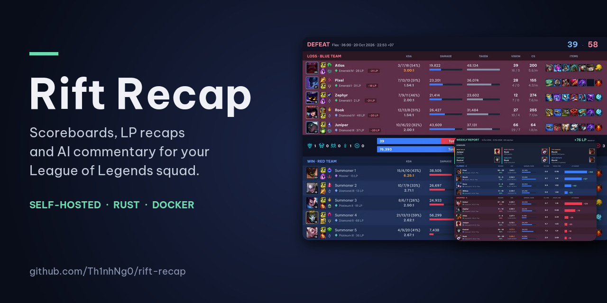
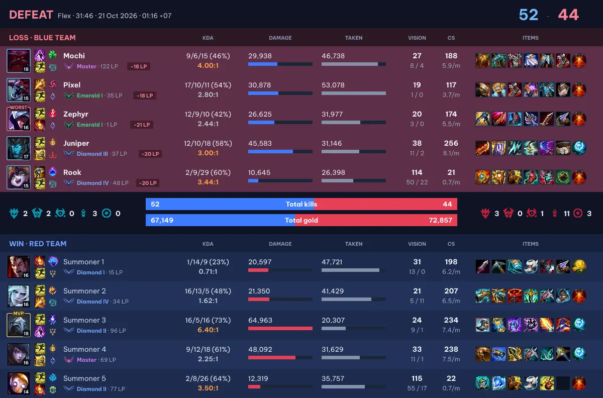
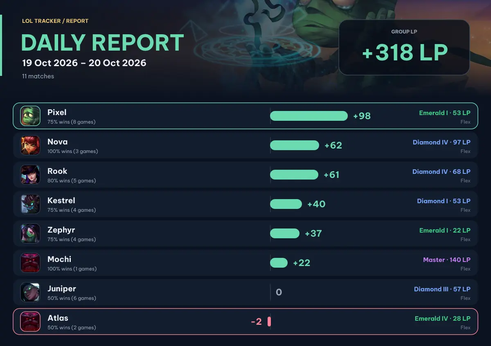
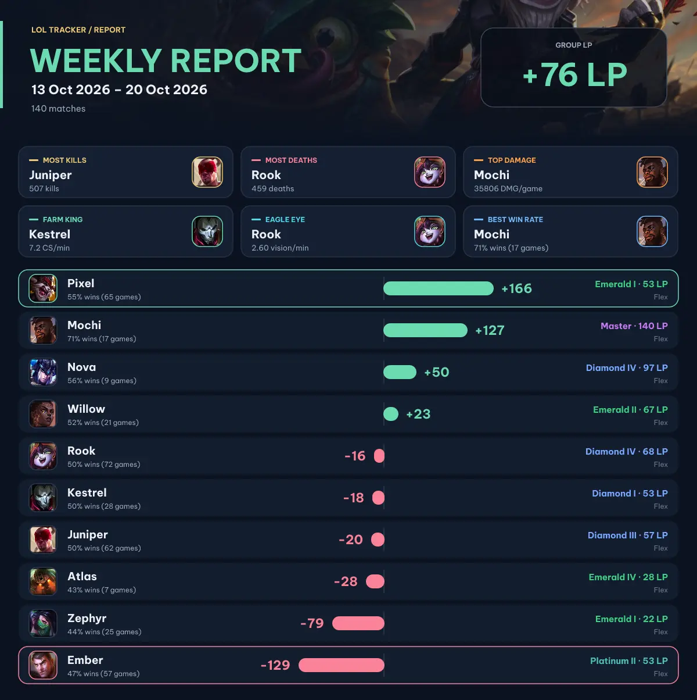
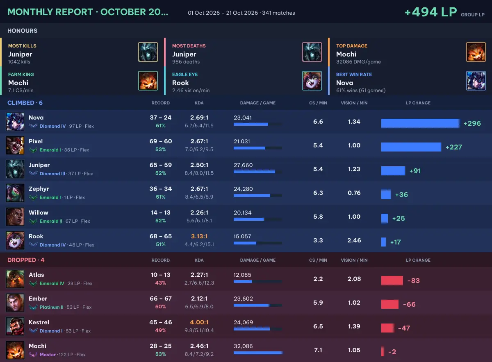
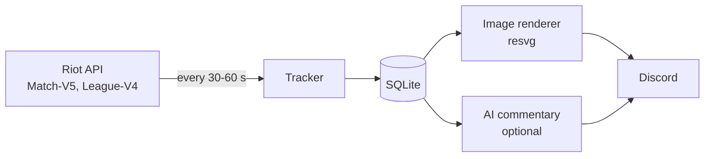

<div align="center">



# Rift Recap

**The Discord bot your League squad has been missing.**<br>
A scoreboard the moment each game ends, LP changes for everyone, funny AI commentary, and daily, weekly and monthly recaps. Self-hosted, around 20 MB of RAM.

[](https://www.rust-lang.org/)
[](#docker)
[](LICENSE)
[](https://github.com/Th1nhNg0/rift-recap/releases)

</div>

## Why

You and your friends grind ranked together, then argue about who carried and who fed. Rift Recap settles it: it watches your games through the official Riot API, posts a full scoreboard to Discord within a couple of minutes, shows exactly how many LP each of you won or lost, and, if you want, roasts the worst player in your own voice.

- **No website, no copy-pasting match links.** Games appear in your channel by themselves.
- **Your server, your data.** One small binary and one SQLite file. No accounts, no tracking, no third-party service.
- **Built for a friend group**, not for the whole ladder: it tracks the people you pick and compares them with each other.



## Features

- **Post-game scoreboard** – one image with splash art of the game's best tracked player, the result, the kill score and gold lead, then a table per team: KDA with kill participation, damage dealt and taken, gold, vision, CS, items, summoner spells and runes. Each team header shows its objectives (dragons, Baron, Herald, towers, inhibitors), average rank and total damage. Images are drawn at 2x and sent as lossy WebP, a few hundred KB each.
- **LP and rank per game** – Solo/Duo and Flex, with the LP gained or lost beside each tracked player and the rank of all ten players. `MVP`, `ACE` and `WORST` labels sit on the portraits.
- **Daily, weekly and monthly reports** – a splash-art header with the group's LP, then players who climbed and players who dropped in two blocks, each with record, KDA, damage, CS, vision and an LP-change bar. Weekly and monthly cards add six honours (kills, deaths, damage, farm, vision, win rate).
- **Optional AI commentary** – a short, funny line per tracked player with a title and emoji, written by any OpenAI-compatible model in the voice *you* define in a `prompt.md`. Custom Discord emojis are supported.
- **Slash commands** – `/lastgame`, `/rank`, `/players` and admin `/config` for channels, roster and on-demand reports.
- **English and Vietnamese** – messages, images and slash-command descriptions.
- **Tiny and self-contained** – one Rust binary. SQLite is bundled, fonts are embedded, images are drawn with `resvg`. No browser, Python or Node. A 31 MB Docker image, around 20 MB of RAM when idle and about 45 MB at peak.

## Screenshots

<table>
<tr>
<td width="50%"><b>Daily report</b><br></td>
<td width="50%"><b>Weekly report</b><br></td>
</tr>
<tr>
<td colspan="2"><b>Monthly report</b> (same layout as weekly, over the calendar month)<br></td>
</tr>
</table>

Everything above is rendered from anonymised sample data. Set `language = "vi"` for Vietnamese output.

### What an AI comment looks like

The scoreboard is posted first, then the commentary is edited into the message text a few seconds later:

> 🔥 **Pixel** — *Furnace Mode*: 17 kills, 10 deaths and 53k damage taken. Everyone was warm, nobody went home.
> 🛡️ **Mochi** — *Held the Line*: 9/6/15 while soaking 46k damage, and the loudest voice in the lobby.
> 👀 **Rook** — *Ward Hoarder*: 114 vision score and 2 kills. The map has never been so well lit or the scoreboard so quiet.
>
> **Key player:** Juniper — 45k damage, the most on the team, in a loss that was decided by six kills.

*(Illustrative text. The tone is entirely controlled by your `prompt.md`.)*

## Quick start

You need three things, whichever way you run it:

- A **Riot API key** from <https://developer.riotgames.com/> with Account-V1, Match-V5 and League-V4. Development keys expire after 24 hours, so register a personal key for a bot that should keep running.
- A **Discord bot** invited with the `bot` and `applications.commands` scopes. In the channels it posts to it needs **View Channel**, **Send Messages** and **Attach Files**. No administrator rights and no privileged intents; only the `GUILDS` intent is used.
- The Riot IDs of your friends.

### Docker

```sh
git clone https://github.com/Th1nhNg0/rift-recap.git && cd rift-recap
mkdir bot
cp config.example.toml bot/config.toml
cp players.example.json bot/players.json
cp .env.example bot/.env          # then edit all three files

docker compose build
docker compose run --rm rift-recap --config /bot/config.toml --env-file /bot/.env run --register-commands
# wait for "Guild tracker commands installed", press Ctrl-C, then:
docker compose up -d
```

The container runs as your user (`UID`/`GID`, default 1000) and keeps the database and artwork cache in `./bot/data`.

### Prebuilt binary

Download the static Linux binary from the [latest release](https://github.com/Th1nhNg0/rift-recap/releases/latest) and run it with the same arguments as below. It has no dependencies.

### From source

```sh
git clone https://github.com/Th1nhNg0/rift-recap.git && cd rift-recap
cargo build --release --locked        # Rust 2024 edition and a C compiler for the bundled SQLite

umask 077
mkdir -p ~/.config/rift-recap
cp config.example.toml ~/.config/rift-recap/config.toml
cp players.example.json ~/.config/rift-recap/players.json
cp .env.example ~/.config/rift-recap/.env
```

1. `.env` – set `RIOT_API_KEY` and `DISCORD_TOKEN`.
2. `config.toml` – set `riot.platform` (for example `vn2`, `na1`, `euw1`), `discord.guild_id`, `games_channel_id` and `rank_channel_id`.
3. `players.json` – your friends' Riot IDs, with an optional display nickname:

   ```json
   [
     { "game_name": "Nova", "tag_line": "VN2", "nickname": "Nova" }
   ]
   ```

   This file only seeds a *new* database. After that, use `/config addplayer` and `/config removeplayer`.

```sh
bin=./target/release/rift-recap
args="--config $HOME/.config/rift-recap/config.toml --env-file $HOME/.config/rift-recap/.env"

$bin $args check                    # validate config and storage, no network
$bin $args probe                    # read-only check of the Riot key and Discord token
$bin $args run --register-commands  # first run: also installs the slash commands
$bin $args run                      # every later start
```

New players are baselined silently the first time they are seen, so the bot never replays old games. Only games that ended within `catch_up_hours` (default 3) of a sweep are announced.

> **Run only one instance per Discord application and database.** For experiments, use a separate database and `run --no-discord`, which tracks without touching Discord and keeps notifications queued.

## Slash commands

| Command | What it does | Who |
|---|---|---|
| `/lastgame` | Posts the latest scoreboard, with AI commentary when enabled | everyone |
| `/rank` | Current Solo/Duo and Flex rank of everyone | everyone |
| `/players` | The tracked roster | everyone (private reply) |
| `/config channel` | Set the channel for match results | Manage Server |
| `/config rankchannel` | Enable, disable or move the report channel | Manage Server |
| `/config addplayer` | Track an account by `Name#Tag` | Administrator |
| `/config removeplayer` | Stop tracking an account (with autocomplete) | Administrator |
| `/config rankreport` | Post a daily, weekly or monthly report now | Manage Server |

Reports are posted automatically once a day at `reports.hour:minute` (default 23:59, `Asia/Ho_Chi_Minh`): the daily report on most days, the weekly one on Sundays, the monthly one on the last day of the month.

## Configuration

Relative paths are resolved against the config file's directory. Unknown keys are rejected so typos fail loudly. See [`config.example.toml`](config.example.toml) for the annotated file.

| Key | Default | Meaning |
|---|---|---|
| `language` | `vi` | `vi` or `en` for all bot output |
| `players_file` | `players.json` | Seed roster for a new database |
| `database` | `data/tracker.db` | SQLite file |
| `retention_days` | `180` | How long old matches and snapshots are kept |
| `riot.platform` | `vn2` | Riot platform routing value |
| `riot.history_interval_secs` | `60` | Seconds between match-history sweeps |
| `riot.catch_up_hours` | `3` | Oldest game that is still announced after downtime |
| `riot.history_count` | `20` | Recent matches fetched per player per sweep |
| `riot.request_interval_ms` | `1250` | Minimum gap between Riot requests (fits a development key) |
| `discord.guild_id` | – | The one server the bot serves |
| `discord.games_channel_id` | – | Where results are posted |
| `discord.rank_channel_id` | `0` | Where reports are posted (`0` disables reports) |
| `reports.enabled`, `monthly`, `timezone`, `hour`, `minute` | on, on, `Asia/Ho_Chi_Minh`, `23`, `59` | Report schedule |
| `llm.*` | disabled | See below |

Secrets are read only from the environment or the dotenv file you pass with `--env-file`: `RIOT_API_KEY`, `DISCORD_TOKEN` and, optionally, `LLM_API_KEY`.

## AI commentary

Off by default; the bot works fully without it. To enable it, point it at any OpenAI-compatible chat-completions endpoint:

```toml
[llm]
enabled = true
model = "gpt-4o-mini"
base_url = "https://api.openai.com/v1"      # OpenRouter, Ollama (http://localhost:11434/v1), a local gateway...
prompt_file = "prompt.md"                   # optional persona and style
send_names = false                          # true lets the prompt use inside jokes about your friends
timeout_secs = 90
```

- Put `LLM_API_KEY` in `.env` (not needed for a server on `localhost`).
- Copy [`prompt.example.md`](prompt.example.md) to `prompt.md` and make it yours. It controls tone and style only; the JSON reply format is enforced by the bot.
- **Custom emojis:** list Discord emoji codes such as `<:name:123456789012345678>` in the prompt file with a short description of each. The bot only accepts codes it finds there, so the model cannot invent one. Emojis uploaded as *application emojis* work everywhere.
- The model receives final statistics of all ten players (the other five are context), the last few comments so it avoids repeating itself, and display names only if `send_names = true`. Never Riot IDs, PUUIDs or Discord IDs. That data goes to the provider you choose.
- Games without commentary, such as imported history, get theirs the first time someone runs `/lastgame`.

## Run it as a service

```ini
# /etc/systemd/system/rift-recap.service
[Unit]
Description=LoL tracker Discord bot
After=network-online.target
Wants=network-online.target

[Service]
WorkingDirectory=/opt/rift-recap
ExecStart=/opt/rift-recap/rift-recap --config /opt/rift-recap/config.toml --env-file /opt/rift-recap/.env run
Restart=always
RestartSec=10
MemoryMax=300M

[Install]
WantedBy=multi-user.target
```

### Updating

Tag a release (`git tag v0.2.0 && git push origin v0.2.0`) and GitHub builds, tests and publishes the static binary with a checksum and a build attestation. A small script on your server, [`deploy/rift-recap-update`](deploy/README.md), pulls new releases, verifies them, backs up the database, swaps the binary, restarts the service and rolls back if it does not come up healthy. Nothing logs in to your server and no deployment secret lives on GitHub.

State lives in one SQLite file in WAL mode. To back it up, stop the service or use SQLite's `.backup`. Pending Discord posts are kept in the database and retried, so a restart or an outage loses nothing.

## How it works



The tracker polls match history for your roster, stores every new game together with rank snapshots, and queues a post in a transactional outbox, so a crash or a Discord outage never loses a result. The renderer draws SVG and rasterises it in-process.

## FAQ

**Is this allowed by Riot?** It only uses the official, public API with your own key and respects its rate limits. It does not scrape, inject or read the game client.

**Can it track players on other regions?** Yes, set `riot.platform` (`na1`, `euw1`, `kr`, `vn2`, ...). One bot serves one Discord server and one platform.

**Do I need the AI part?** No. It is off by default and the bot is fully useful without it.

**How much does it cost to run?** Next to nothing: about 20 requests per minute to Riot, a few MB of disk, and a 1 vCPU, 256 MB machine is plenty.

**Why a bot and not a web page?** Your squad is already in Discord. Results show up where you talk, with nothing to open.

## Development

```sh
cargo build --locked
./target/debug/rift-recap --env-file .env render-scoreboard --language all --output data/board.webp
./target/debug/rift-recap --env-file .env render-report --period weekly --language all --output data/report.webp
```

`render-scoreboard` draws a stored or recent real match to a WebP (add `--post` to send one image to the games channel). `render-report` does the same for a report and prints its text form. Neither imports matches, touches baselines or calls an LLM.

| Path | Role |
|---|---|
| `src/tracker.rs` | History sweeps, rank snapshots, LP attribution |
| `src/riot.rs` | Rate-limited Riot client |
| `src/store.rs` | SQLite storage and the delivery outbox |
| `src/discord.rs` | Gateway, slash commands, delivery and commentary workers |
| `src/render.rs`, `src/report_card.rs`, `src/render_assets.rs` | SVG images rasterised by `resvg`; Data Dragon and objective artwork cache |
| `src/reports.rs`, `src/presentation.rs` | Report aggregation and the role-aware MVP / worst-player score |
| `src/llm.rs` | Optional commentary client |
| `src/i18n.rs` | Compile-checked English and Vietnamese catalogue |

Artwork (champions, items, objective icons) is fetched from public Data Dragon and Community Dragon URLs at render time and cached next to the database; nothing from Riot is committed. If it cannot be fetched, images fall back to placeholders. No Riot API key is ever sent to those hosts.

## Contributing

Issues and pull requests are welcome. Good first areas: more languages in `src/i18n.rs` (every message has one string per language and the compiler checks the catalogue), new report honours, and support for more queues. Please keep the project dependency-light and the binary self-contained.

If Rift Recap made your squad's ranked nights more fun, a star helps others find it.

## Legal

Rift Recap is not endorsed by Riot Games and does not reflect the views or opinions of Riot Games or anyone officially involved in producing or managing Riot Games properties. Riot Games and all associated properties are trademarks or registered trademarks of Riot Games, Inc.

The bundled Be Vietnam Pro fonts are licensed under the SIL Open Font License 1.1 ([`assets/fonts`](assets/fonts)). The code is released under the [MIT License](LICENSE).
